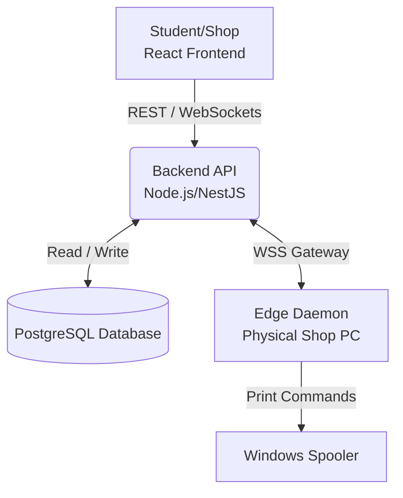

<div align="center">

# ⚙️ PrintFlow - Backend API & Edge Daemon

<a href="https://readme-typing-svg.herokuapp.com">
  
</a>

<p align="center">
  
  
  
  
  
</p>

</div>

<br />

## 📖 Context

This Node.js/NestJS application is the central nervous system for CIT-U's PrintFlow. It houses the PostgreSQL database schema, the OpenAI Agentic AI verification routes, and the Socket.io WSS Gateway that communicates with the physical print daemons installed on the shop computers.

---

## 🏗 Architecture Diagram



---

## 🔄 Order State Machine

The lifecycle of an order follows a strict state machine to ensure data integrity and proper payment procurement:

| State               | Description                                                                 |
| :------------------ | :-------------------------------------------------------------------------- |
| `OPEN_INQUIRY`      | Order created, pricing auto-calculated, pending student payment submission. |
| `AWAITING_PAYMENT`  | Payment receipt submitted by student; awaiting shop verification.           |
| `PROOF_APPROVED`    | Payment verified by the shop; document is cleared for printing.             |
| `IN_PRODUCTION`     | The Edge Daemon has spooled the document to the physical printer.           |
| `READY_FOR_PICKUP`  | Printing finished successfully. Student is notified.                        |
| `COMPLETED`         | Student has picked up the document. Transaction closed.                     |
| `ESCALATED_DISPUTE` | Shop rejected the payment, and the student appealed to System Admins.       |

---

## 🔐 Environment Variables

Create a `.env` file in the root of the repository with the following keys:

```env
NODE_ENV=development
PORT=3000
FRONTEND_URL=http://localhost:5173
ADMIN_URL=http://localhost:3001
SUPABASE_URL=https://your-project.supabase.co
SUPABASE_SERVICE_ROLE_KEY=replace-with-your-rotated-service-role-key
JWT_SECRET=replace-with-at-least-32-random-characters
# Optional; permit review falls back to manual review when absent.
OPENAI_API_KEY=
```

---

## Production deployment

The included `render.yaml` builds the backend from `Dockerfile`, using Node
24.14.1 and LibreOffice Writer. LibreOffice is required to convert DOCX order
uploads into PDFs; image uploads are also normalized to PDF before storage.
Every converted page is proportionally fitted and centered on the paper size
selected for the order, with landscape source pages kept in landscape.
The service starts `dist/src/main.js` and uses `/health` as Render's liveness
check. Before deploying:

1. Apply `supabase/migrations/20260915_security_hardening.sql` to the production
   Supabase project.
2. Rotate the previously exposed Supabase service-role key and set the new
   value as `SUPABASE_SERVICE_ROLE_KEY`.
3. Set `FRONTEND_URL` and `ADMIN_URL` to the exact HTTPS origins of the two
   deployed static sites. Do not include a trailing slash or a path.
4. Generate a new `JWT_SECRET`. Existing admin sessions will be invalidated.
5. Deploy the backend, then rebuild both Vite sites so their build-time
   `VITE_API_URL` and Supabase public variables are embedded correctly.

The frontend and admin repositories each include their own Render Blueprint
with an SPA fallback rewrite. A direct visit to `/health` must return a JSON
response whose `status` is `ok` before traffic is switched to the new backend.

---

## 📡 Edge Daemon Setup

Physical print shops must run the local daemon script to connect their local Windows Spooler to the cloud WSS Gateway.

1. Locate the daemon script within the shop portal or backend utilities folder.
2. Run the script on the shop's dedicated printing PC:

```bash
npm run daemon
```

3. Sign in with a verified print-shop account. The launcher passes only that shop's short-lived access token to the daemon; it never uses the Supabase service-role key.

### Windows Printer Agent

The production replacement for the terminal daemon lives in `agent/`. It uses a
one-time shop login to register the Windows computer, protects the resulting
device credential with Windows DPAPI, starts at user login, refreshes short-lived
agent tokens, and reconnects to the Socket.IO gateway automatically.

Apply `supabase/migrations/20260917_daemon_devices.sql` before enabling agent
registration. Production also requires a stable `AGENT_JWT_SECRET` containing at
least 32 characters.

Run the agent from source during development:

```bash
npm run agent
```

Build the Windows installer:

```bash
npm run agent:build:windows
```

The generated installer and checksum metadata are written to `agent/release/`.
Build output is intentionally ignored by Git. The build uses a bundled Node
single-executable agent and a per-user Windows installer, so a shop computer does
not need Node.js or the source repository.

To publish the current installer to the private Supabase `agent-releases` bucket:

```bash
npm run agent:publish:windows
```

The publish command prints the `AGENT_WINDOWS_STORAGE_PATH`, version, checksum,
and publication-time values that must be copied into the deployed backend's
environment. The clerk-side **Printer Agent** page requests a short-lived signed
download URL from the backend. `AGENT_WINDOWS_DOWNLOAD_URL` can instead point to
an externally hosted installer.

---

## 👥 Contributors

Proudly developed by the PrintFlow team:

- **Jude Mikael Valencia**
- **Karol Vincent Bebedor**
- **Noeh Arbee Boiser**
- **Aldrin Suse**
