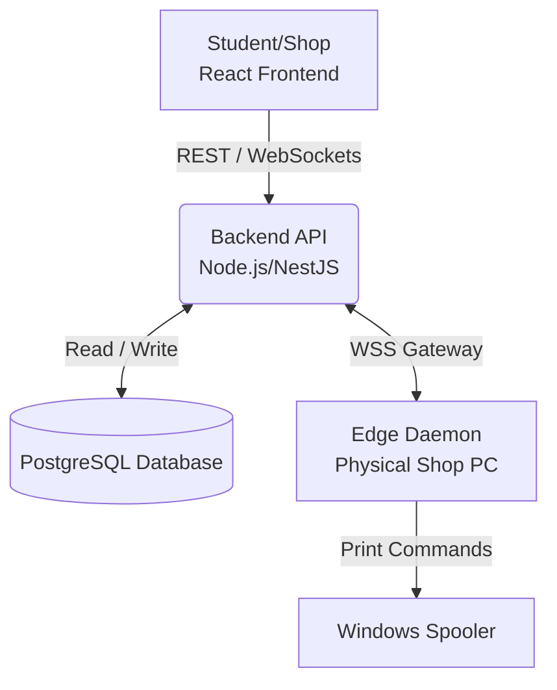

<div align="center">

# ⚙️ PrintFlow - Backend API & Edge Daemon

<a href="https://readme-typing-svg.herokuapp.com">
  
</a>

<p align="center">
  
  
  
  
  
</p>

</div>

<br />

## 📖 Context

This Node.js/NestJS application is the central nervous system for CIT-U's PrintFlow. It houses the PostgreSQL database schema, the OpenAI Agentic AI verification routes, and the Socket.io WSS Gateway that communicates with the physical print daemons installed on the shop computers.

---

## 🏗 Architecture Diagram



---

## 🔄 Order State Machine

The lifecycle of an order follows a strict state machine to ensure data integrity and proper payment procurement:

| State               | Description                                                                 |
| :------------------ | :-------------------------------------------------------------------------- |
| `OPEN_INQUIRY`      | Order created, pricing auto-calculated, pending student payment submission. |
| `AWAITING_PAYMENT`  | Payment receipt submitted by student; awaiting shop verification.           |
| `PROOF_APPROVED`    | Payment verified by the shop; document is cleared for printing.             |
| `IN_PRODUCTION`     | The Edge Daemon has spooled the document to the physical printer.           |
| `READY_FOR_PICKUP`  | Printing finished successfully. Student is notified.                        |
| `COMPLETED`         | Student has picked up the document. Transaction closed.                     |
| `ESCALATED_DISPUTE` | Shop rejected the payment, and the student appealed to System Admins.       |

---

## 🔐 Environment Variables

Create a `.env` file in the root of the repository with the following keys:

```env
NODE_ENV=development
PORT=3000
FRONTEND_URL=http://localhost:5173
ADMIN_URL=http://localhost:3001
SUPABASE_URL=https://your-project.supabase.co
SUPABASE_SERVICE_ROLE_KEY=replace-with-your-rotated-service-role-key
JWT_SECRET=replace-with-at-least-32-random-characters
# Optional; permit review falls back to manual review when absent.
OPENAI_API_KEY=
```

## 🖨️ Windows Printer Agent

The printer agent connects PrintFlow to the printers installed on a shop's
Windows computer. Shop staff use the installer from the dashboard. They do not
need to download the source code, install Node.js, or run terminal commands.

### Setting up a shop computer

Once the shop has been approved:

1. Connect the printer and make sure it works normally in Windows.
2. Open **Printer Agent** from the PrintFlow shop dashboard.
3. Download and run the Windows installer.
4. Sign in with the approved shop account when the setup page opens.
5. Go back to the **Printer Agent** page. The computer should show as
   **Connected**, and the installed printer should appear in the list.

If a printer is missing, use **Rescan printers**. The agent starts automatically
when the Windows user signs in and reconnects after temporary network problems.
For now, each shop can have one active printing computer.

### Printing orders

After a payment is approved, the order appears under **Print Ready**. Select the
orders you want to print, choose a printer, and click **Send to Daemon (Batch)**.
The agent sends each job to the printer one at a time and reports the result back
to the dashboard.

Simply connecting a printer does not print everything in the queue. The clerk
still chooses which orders to send.

PrintFlow accepts PDF, DOCX, JPG, PNG, and WEBP files. Images and DOCX files are
converted to PDF before printing. Each page is resized to fit the selected
Short, A4, or Long paper without stretching it, and landscape pages stay in
landscape.

### Server setup

Apply these migrations before allowing shops to register printer agents:

```text
supabase/migrations/20260917_daemon_devices.sql
supabase/migrations/20260918_cleanup_revoked_daemon_devices.sql
```

Set `AGENT_JWT_SECRET` to a stable secret with at least 32 characters. Keep
`ALLOW_LEGACY_DAEMON_AUTH=false` in production. The backend must run from the
included Dockerfile because it installs LibreOffice for DOCX conversion.

### Development and releases

To run the current agent from source while developing:

```bash
npm run agent
```

The older `npm run daemon` command is kept only for legacy local testing. It
starts the old terminal-based daemon and should not be used by shop staff.

Build the Windows installer from a Windows development computer:

```bash
npm run agent:build:windows
```

The finished installer and its checksum are placed in `agent/release/`. This
folder is ignored by Git. The installer already contains the runtime and
printing dependencies needed by the shop computer.

Publish the installer to the private Supabase `agent-releases` bucket:

```bash
npm run agent:publish:windows
```

After publishing, copy the printed storage path, version, checksum, and
publication time into the matching `AGENT_WINDOWS_*` environment variables on
the deployed backend. Redeploy the backend so the **Printer Agent** page offers
the new installer. You can also use `AGENT_WINDOWS_DOWNLOAD_URL` when the
installer is hosted somewhere else.

---

## 👥 Contributors

Proudly developed by the PrintFlow team:

- **Jude Mikael Valencia**
- **Karol Vincent Bebedor**
- **Noeh Arbee Boiser**
- **Aldrin Suse**
